# Morph Core — High-Performance Stealth UDP RAW IP Tunnel

> **Pure Rust, Zero-Allocation Layer-3 VPN & Anti-DPI Transport Engine**  
> Full 1500 MTU across **all protocols (TCP, QUIC/HTTP3, UDP, ICMP, DNS)** via Tunnel-Level Micro-Segmentation, **16 nDPI-conforming Camouflage Protocols**, **3 Payload Protection Modes**, **Policy-Based Split Tunneling**, and a **Native Tauri v2 Desktop GUI** + **Cloaked Web Admin Console** — running in **under 8 MB RAM** on Nano Linux VPS nodes.

---

## Key Capabilities at a Glance

| Category | Capability |
| :--- | :--- |
| **Transport Architecture** | Two-Stage Connected UDP (`sk_dst_cache` kernel FIB bypass) + Lock-Free Wintun (Windows) & `tun0` (Linux) |
| **Universal 1500 MTU** | Layer-3 Micro-Segmentation (`> 1200B` auto-split) with 256-slot sequence-associative reassembly (< 400 KB RAM) |
| **Stealth Camouflage** | **16 real-world UDP protocols** (QUIC v1/v2, WebRTC, DTLS, DNS, IPsec ESP, uTP, RakNet, STUN, TURN, Steam, SDR, Riot, Zoom, RDP, Discord) with zero-config server auto-detection |
| **Payload Protection** | **3 harmonized modes**: Protocol-Conforming DPI Shaping, 64-bit Fast Stream Cipher, and Plaintext Passthrough — with domain-separated fragment keystreams (Zero Two-Time Pad) |
| **Authentication** | Full 64-bit PSK authentication across all 16 wire headers + silent drop for unauthorized packets + encrypted `morph://` subscription tokens |
| **Smart Split Routing** | Compile-time categorized CIDR split tunneling with explicit NextHop (`10.8.0.1` / `fd00:8::1`), Zero-RTT DNS Snooper & Cache, RFC 6724 IPv6 elevation, and Zero-Leak DNS Firewall |
| **Server Self-Tuning** | Automatic Alpine Linux (OpenRC) & Debian/Ubuntu (systemd) detection, BBR + FQ congestion control, and Hardware RAM Guardrails (runs stably on **93 MB RAM** Nano VPS) |
| **Management & UI** | Native Windows **Tauri v2 Desktop GUI** (live telemetry waveform, token manager, protocol switcher) + **Cloaked Server Admin Web Console** (anti-scanner 404 cloaking, user quotas, token generator) |

---

## System Architecture

```mermaid
flowchart LR
    subgraph Windows["Windows Client (Rust + Tauri v2 + Wintun)"]
        Apps["Apps (Browser / QUIC / TCP / UDP / DNS)"]
        Wintun["Wintun L3 Adapter (MTU 1500)"]
        Split["Policy Split Router & Zero-RTT DNS Snooper"]
        SegC["L3 Micro-Segmentation (>1200B Split)"]
        CryptoC["Payload Protection (Shaped / Stream / Plain)"]
        MimicC["16-Protocol Mimicry Wrapper (20B Header)"]
        SockC["Connected UDP Socket (16MB WinSock2)"]

        Apps --> Split --> Wintun --> SegC --> CryptoC --> MimicC --> SockC
    end

    subgraph Wire["Physical Network (IPv6 / IPv4)"]
        UDP["Stealth UDP Datagrams (<= 1280B Safe Wire Ceiling)"]
    end

    subgraph Linux["Linux Edge Server (Static Musl Binary < 8MB RAM)"]
        Stage1["Stage 1: Multi-Port ReusePort Listeners (14 Ports)"]
        Stage2["Stage 2: Sharded Connected UDP Workers (dst_cache)"]
        Detect["Auto-Detector & Full 64-bit PSK Verifier"]
        ReasmS["256-Slot Associative Reassembly Buffer"]
        TunS["Linux tun0 (MTU 1500 + BBR + FQ)"]
        Egress["NAT44 / NAT66 & Local dnsmasq"]

        Stage1 -->|Handshake & Upgrade| Stage2
        Stage2 --> Detect --> ReasmS --> TunS --> Egress
    end

    SockC <--> UDP <--> Stage1
    UDP <--> Stage2
```



---

## Feature Deep-Dive

### 1. All 16 Stealth Camouflage Protocols

Every tunnel datagram is encapsulated in a fixed **20-byte protocol-conforming wire header** engineered against RFC specifications and nDPI dissectors. The server binds all standard ports concurrently **and** runs zero-config auto-detection (`port_hint_and_auto_detect` + `auto_detect_and_unwrap`), meaning **any of the 16 protocols works both on its official port AND on any custom/emergency port (e.g., `7190` or `443`)**.

| # | CLI ID | Protocol | Default Port | Wire Signature / Standard | Shaped DPI Inner Framing |
| :-: | :--- | :--- | :-: | :--- | :--- |
| 1 | `quic_v1` | **QUIC v1 / HTTP/3** | `443` | RFC 9000 Short Header (`0x43` + 8B DCID) | Native AEAD Ciphertext (0B) |
| 2 | `quic_v2` | **QUIC v2 / RFC 9369** | `443` | RFC 9369 Initial (`0xD3` + `0x6B3343CF` + 8B DCID) | Native AEAD Ciphertext (0B) |
| 3 | `webrtc` | **WebRTC / SRTP** | `3478` | RFC 3550 RTP v2 PT=96 (`0x80 0x60` + SSRC) | 2B Opus 20ms TOC (`0x78 0x0B`) |
| 4 | `dtls` | **DTLS 1.2** | `443` | RFC 6347 App Data (`0x17 0xFE 0xFD` + FragLen) | Native Record Ciphertext (0B) |
| 5 | `dns` | **DNS / mDNS** | `5353` | RFC 1035 Standard Query (`0x0100 0x0001` + QTYPE A) | 2B DNS QCLASS IN (`0x00 0x01`) |
| 6 | `esp` | **IPsec NAT-T ESP** | `4500` | RFC 3948 ESP Header (32-bit SPI + 32-bit Seq) | Native ESP Ciphertext (0B) |
| 7 | `utp` | **uTP BitTorrent** | `6881` | RFC 6817 uTP v1 (`0x01 0x00` + ConnID + 1MB Win) | Native MSE Ciphertext (0B) |
| 8 | `raknet` | **RakNet Game Stream** | `19132` | Connected Data (`0x84` + 24-bit LE Seq + BitLen) | 1B Game Channel (`0x04`) |
| 9 | `stun` | **STUN / ICE Media** | `3478` | RFC 5389 Binding (`0x0001` + Magic Cookie `0x2112A442`) | 4B STUN DATA TLV (`0x0013` + Len) |
| 10 | `turn` | **TURN ChannelData** | `3478` | RFC 5766 Channel `0x4001` + 16-bit Length | 2B Opus 20ms TOC (`0x78 0x0B`) |
| 11 | `steam` | **Steam / Valve Source** | `27015` | A2S Datagram (`0xFFFFFFFF 0x55`) | 1B Game Channel (`0x04`) |
| 12 | `sdr` | **Valve SDR (CS2)** | `27020` | `0x0800` + `"sdping"` + AppID 730 | 1B Game Channel (`0x04`) |
| 13 | `riot` | **Riot Games / Valorant** | `7500` | Channel 1 `"RG"` (`0x00015247`) + Session ID | 1B Game Channel (`0x04`) |
| 14 | `zoom` | **Zoom SFU Media** | `8801` | Zoom SFU Marker (`0x01 0x00 0x03 0x00`) | 2B Zoom SFU Audio (`0x0F 0x00`) |
| 15 | `rdp` | **Microsoft RDP UDP** | `3389` | MS-RDPEUDP SYN (`0xFFFFFFFF 0x0000 0x0001` + MTU) | 2B TPKT v3 Marker (`0x03 0x00`) |
| 16 | `discord` | **Discord Voice** | `50000` | Discord RTP PT=120 (`0x80 0x78` + Discord SSRC) | 2B Opus 20ms TOC (`0x78 0x0B`) |

- **Full 64-Bit PSK Authentication**: Every single one of the 16 protocols cryptographically authenticates **all 8 bytes (64 bits)** of the subscriber PSK inside its wire header. Unauthorized probes or spoofed packets are dropped silently with zero response.
- **Dynamic Mid-Session Adaptation**: If a client reconnects or switches camouflage protocol or encryption mode, the server seamlessly updates its worker registry, session cache, and IP routing table (`ip_table`) immediately with zero downtime.

---

### 2. Three Harmonized Payload Protection Modes

All three modes work seamlessly across all 16 camouflage protocols and across both standard (`FLAG_DATA`) and micro-segmented (`FLAG_FRAG_1` / `FLAG_FRAG_2`) frames:

1. **`shaped` — Protocol-Conforming DPI Shaping (Default / Recommended)**
   - Prepends protocol-authentic inner headers (Opus TOC, STUN TLV DATA attribute, DNS QCLASS IN, Zoom SFU audio marker, RDPEUDP TPKT, or game stream opcodes) before encrypting the payload with our 64-bit SplitMix64 word stream cipher.
   - Evades Shannon entropy heuristics and protocol-payload deep inspection.
2. **`stream` — Fast 64-Bit Word Stream Cipher**
   - Encrypts the payload directly in 64-bit CPU registers with zero extra framing bytes.
   - Provides confidentiality and high-entropy ciphertext with minimal CPU and wire overhead.
3. **`plaintext` — Zero-Overhead Raw IP Passthrough**
   - Sends raw inner IP packets directly after the 20-byte camouflage header with zero encryption CPU cost.
   - Ideal for maximum line-rate throughput when inner traffic is already end-to-end encrypted (HTTPS / TLS 1.3 / QUIC).

> **Zero Two-Time Pad Guarantee**: When a packet is split by Micro-Segmentation into `FLAG_FRAG_1` and `FLAG_FRAG_2`, both fragments share the wire sequence number `seq` for reassembly, while Fragment 2 derives an independent cipher nonce via `fragment_cipher_seq(seq, true) = seq ^ 0xA55A`. Frag 1 and Frag 2 never reuse the same keystream.

---

### 3. Adaptive Single-Frame PMTU + Universal Micro-Segmentation Safety Net

Morph Core combines **zero-fragmentation wire speed** with **universal protocol resilience** across TCP, QUIC/HTTP3, UDP, ICMP, and DNS:

- **Connect-Time Dynamic Wire PMTU Discovery**: Actively probes `DF=1` wire path capacity (e.g., 1480B / 1500B / 1400B) and calculates the exact single-datagram inner MTU (`wire_pmtu - transport_overhead`, e.g. `1412B`). Normal TCP and QUIC packets flow as **1 single UDP datagram** with **1x PPS, 1x packet loss, and zero fragmentation overhead**.
- **Universal Layer-3 Micro-Segmentation Safety Net**: Linux `tun0` stays open at full `1500` ceiling MTU. Any oversized packet (`pkt_len > negotiated_mtu`, up to `1500B`) from UDP, QUIC, ICMP, or legacy apps is transparently bifurcated into `FLAG_FRAG_1` + `FLAG_FRAG_2` and reassembled without drops or PMTU black-holes.
- **256-Slot Sequence-Associative Reassembly Buffer (Lazily Allocated)**:
  - Handles in-order, out-of-order, and interleaved fragment delivery with **zero heap allocations** and zero extra clock syscalls on the hot path.
  - Lazily allocated per worker (< 400 KB when active, 0 bytes on idle listener ports), keeping the entire Linux edge server at **~2–4 MB RAM** and **0.0% idle CPU** via kernel `poll()`.

---

### 4. Policy-Based Split Tunneling, Zero-RTT DNS Snooper & Zero-Leak Barrier

- **Categorized Compile-Time CIDR Routing** (`rust-client/src/client/routes/`):
  - Embedded service route lists (`google_services.txt`, `social_and_cdn_services.txt`, `leak_test_services.txt`) are applied in a single atomic batch (< 200 ms) with explicit `nexthop=10.8.0.1` (IPv4) and `nexthop=fd00:8::1` (IPv6) so Windows delivers packets directly into Wintun with zero ARP/NDP fallback leaks.
  - Default domestic traffic (`0.0.0.0/0` & `::/0`) stays on the physical gateway for zero latency penalty.
- **Zero-RTT In-Memory DNS Cache & Dynamic Snooper** (`dns_snooper.rs`):
  - Intercepts repeat DNS queries in-memory in **< 0.1 ms** before they ever hit the wire.
  - Inspects DNS A/AAAA responses, skips domestic/loopback/server IPs (preventing routing loops), and dynamically injects `/32` and `/128` host routes directly into the Windows kernel FIB via native Win32 `CreateIpForwardEntry2` (< 0.05 ms).
- **RFC 6724 IPv6 Elevation & Anti-Leak Firewall**:
  - Elevates tunnel IPv6 prefix precedence (`50 > 35`) for clean IPv6 egress.
  - Blocks outbound port 53 UDP/TCP on physical interfaces and disables Windows Smart Multi-Homed Name Resolution (`DisableSmartNameResolution`), automatically restoring all rules on exit or crash recovery (`clean_stale_routes_and_nrpt`).

---

### 5. Linux Server Auto-Tuner, Nano-VPS Guardrails & Cloaked Admin Console

- **OS & Hardware Auto-Adaptation**: Automatically detects Alpine Linux (OpenRC) vs Debian/Ubuntu (systemd), configures IPv4/IPv6 forwarding, enables **BBR + FQ**, configures `tun0` + NAT44/NAT66 + local `dnsmasq`, and enforces safe memory guardrails (`CapacityManager`).
- **Ultra-Low Footprint**: Compiles to a **~1.1 MB static musl binary** consuming **~7–8 MB RSS** at runtime.
- **Multi-User & Cloaked Web Admin Dashboard**:
  - Manage subscribers, per-user IPv4/IPv6 assignments, quotas, expiration dates, concurrent connection limits, and one-click encrypted **`morph://` subscription tokens**.
  - Protected behind a randomized secret URL prefix (`/v2/sys/telemetry/node-XXXXXXXX/auth/console`) — all scans to `/` or common admin paths return `404 Not Found`.

---

## Project Structure

```text
fast-udp-tunnel/
├── README.md
├── LICENSE
├── .gitignore
├── ui/                                 # Tauri v2 Desktop GUI frontend (source mirror)
└── rust-client/                        # Unified Rust Client (Windows) & Server (Linux) crate
    ├── Cargo.toml
    ├── build.rs                        # Windows manifest & Tauri build script
    ├── tauri.conf.json                 # Tauri v2 desktop configuration
    ├── icons/                          # Application & system tray icons
    ├── ui/                             # Embedded Tauri v2 HTML5/CSS/JS frontend
    └── src/
        ├── main.rs                     # Unified CLI & GUI entry point
        ├── gui_bridge.rs               # Tauri IPC commands & tray controller (Windows)
        ├── common/
        │   ├── constants.rs            # Protocol flags, ports, MTU & buffer constants
        │   ├── fragment.rs             # L3 Micro-Segmentation & 256-slot ReassemblyBuffer
        │   ├── pmtu.rs                 # Connect-time DF=1 Path MTU Discovery
        │   ├── token.rs                # Encrypted morph:// subscription token codec
        │   ├── net_utils.rs            # IP parsers, RFC 1071 checksum, ICMP prober
        │   ├── bench.rs                # Throughput & latency benchmark suite
        │   └── chaos.rs                # End-to-end chaos & audit runner
        ├── core/
        │   ├── crypto.rs               # PSK KDF, 64-bit word cipher, 3-mode payload shaper
        │   └── metrics.rs              # Lock-free RTT & throughput telemetry
        ├── mimic/
        │   ├── mod.rs                  # 16-profile dispatcher, port hints & auto-detector
        │   ├── quic_v1.rs ... discord.rs # All 16 protocol wire codecs
        │   └── tests.rs                # Exhaustive 48-way protocol x mode x frag test suite
        ├── client/                     # Windows Client Engine
        │   ├── engine.rs               # Full-duplex Wintun <-> UDP forwarding & prober
        │   ├── wintun.rs               # Native Win32 IP/MTU config & Wintun ring session
        │   ├── socket.rs               # 16MB WinSock2 connected UDP socket
        │   ├── routing.rs              # Physical gateway protection, IPv6 policy & firewall
        │   ├── dns_snooper.rs          # Zero-RTT DNS cache & dynamic Win32 host router
        │   ├── config_manager.rs       # Profile store (morph_profiles.dat) & endpoint selector
        │   └── routes/                 # Modular compile-time split-tunnel CIDR lists
        └── server/                     # Linux Multi-User Edge Server
            ├── mod.rs                  # Multi-port SO_REUSEPORT listener bootstrap
            ├── engine.rs               # Two-Stage Connected UDP engine & IP routing table
            ├── tun.rs                  # Linux /dev/net/tun non-blocking device wrapper
            ├── network.rs              # NAT44/NAT66, forwarding & DNS redirect rules
            ├── users.rs                # Thread-safe multi-user store (users.json)
            ├── admin_web.rs            # Cloaked HTTP Admin Console & REST API
            ├── tuner/                  # Alpine / Debian / Ubuntu kernel auto-tuners
            ├── capacity/               # Hardware-aware RAM/CPU guardrail scaler
            └── web/admin.html          # Embedded single-file Admin Dashboard UI
```

---

## Building from Source

### Prerequisites
- **Rust toolchain** (`rustup` 1.75+)
- For cross-compiling the static Linux server from Windows:
  ```bash
  rustup target add x86_64-unknown-linux-musl
  ```
- Place `wintun.dll` (from [wintun.net](https://www.wintun.net/)) next to the Windows executable.

### 1. Build Windows Client (GUI + CLI)
```bash
cd rust-client
cargo build --release
# Output: target/release/fast-udp-tunnel.exe
```

### 2. Build Static Linux Server (x86_64 Musl — Works on Alpine, Debian, Ubuntu)
```bash
cd rust-client
cargo build --release --target x86_64-unknown-linux-musl
# Output: target/x86_64-unknown-linux-musl/release/fast-udp-tunnel (~1.1 MB static binary)
```

---

## Quick Start & Usage

### Server Deployment (Linux)
Copy the static binary to your VPS and run as `root`:

```bash
chmod +x fast-udp-tunnel
./fast-udp-tunnel --mode server \
  --port 7190 \
  --admin-port 9090 \
  --server-v4 <YOUR_SERVER_IPV4> \
  --server-v6 <YOUR_SERVER_IPV6> \
  --os-profile auto
```

On startup, the server automatically:
1. Tunes kernel parameters (`ip_forward`, `BBR`, `FQ`, socket buffers).
2. Initializes `tun0` (`10.8.0.1/24` & `fd00:8::1/64`, MTU `1500`) and NAT44/NAT66 rules.
3. Binds all 14 multi-protocol UDP ports concurrently (`7190, 443, 3478, 19132, 27015, 27020, 7500, 8801, 3389, 50000, 5353, 4500, 6881, 53`).
4. Prints the cloaked **Edge Manager Admin Console** URL and credentials to generate `morph://` client tokens.

### Client Usage (Windows — Run as Administrator)

- **Desktop GUI Mode**: Double-click `fast-udp-tunnel.exe` (Run as Administrator) with no arguments to launch the Tauri v2 desktop app. Import your `morph://` token in the **Tokens** tab, optionally pick any of the **16 Camouflage Protocols** and **3 Payload Modes** in **Options**, and click **Connect**.
- **CLI Mode**:
  ```powershell
  # Import a subscription token
  .\fast-udp-tunnel.exe --import "morph://<BASE64_TOKEN>"

  # List saved profiles
  .\fast-udp-tunnel.exe --list

  # Connect to saved profile #1 (with optional protocol & mode overrides)
  .\fast-udp-tunnel.exe --connect 1 --mimic quic_v2 --payload shaped
  .\fast-udp-tunnel.exe --connect 1 --mimic webrtc --port 3478 --payload stream
  .\fast-udp-tunnel.exe --connect 1 --mimic discord --payload plaintext
  ```

---

## Verification & Automated Testing

Run the full release unit test suite (compiles under `#![deny(warnings)]`):

```bash
cd rust-client
cargo test --release
```

The test suite verifies:
- **`test_all_16_profiles_wrap_unwrap`**: Header wrap/unwrap, zero-config auto-detection, and intruder PSK rejection for all 16 protocols.
- **`test_port_hints_and_emergency_overrides`**: Standard port fast-path and cross-port emergency overrides (e.g., Zoom, Riot, Discord, SDR, RakNet, RDP over port `443`).
- **`test_all_16_profiles_x_3_modes_and_micro_segmentation`**: Full 48-way matrix (`16 profiles × 3 payload modes`) testing both unfragmented packets and out-of-order 1500-byte micro-segmented packets + independent fragment keystream verification.
- **`test_full_64bit_psk_sensitivity_all_16_profiles`**: Flips every single byte (`0..8`) of the 64-bit PSK across all 16 protocols to prove 100% bit coverage.
- **`common::fragment::tests`**: In-order, out-of-order, and interleaved micro-segment reassembly tests.
- **`common::token::tests`**: Encrypted `morph://` subscription URI serialization round-trip.

To run the optional live network handshake test against your own deployed server:
```powershell
$env:MORPH_TEST_SERVER="<YOUR_SERVER_IPV6>"
cargo test --release test_live_server_roundtrip_all_profiles -- --ignored --nocapture
```

---

## Security & Responsible Use Notice

- Never commit `morph_profiles.dat`, `users.json`, or `admin_config.json` (already excluded by `.gitignore`).
- This project is intended for network engineering research, privacy protection, and resilient enterprise/personal tunneling.

## License

Licensed under the [MIT License](LICENSE).
