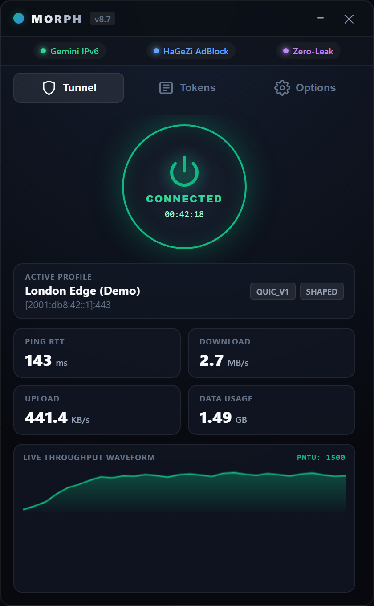
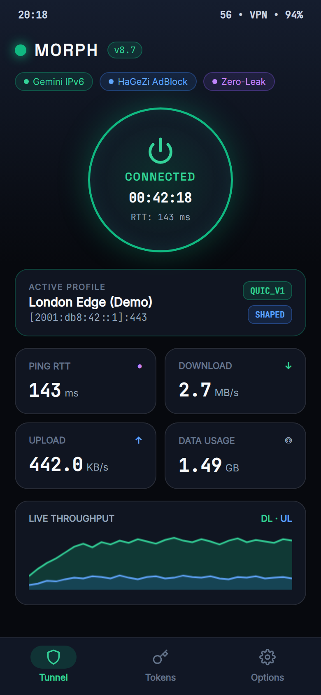
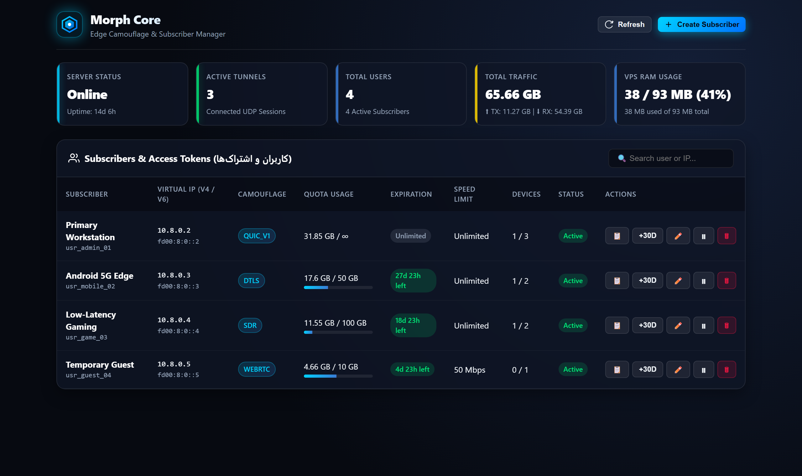

# Morph Core (`fast-udp-tunnel`)

A high-throughput, Layer-3 RAW IP UDP tunnel written in pure Rust—sharing one unified core across a **Linux Multi-User Server**, **Windows Desktop Client (`Wintun` + Tauri)**, and **Android VPN App (`VpnService` + Jetpack Compose)**.

Built for hostile cellular/ISP networks with DPI filtering, MTU black holes, and dirty IPv4 datacenter blocks.

| Windows Desktop Client | Android App (Jetpack Compose) | Cloaked Web Admin Console |
| :---: | :---: | :---: |
|  |  |  |

---

## Why Morph Core? (Key Differentiators)

- **True Layer-3 UDP Tunnel + 1200B Micro-Segmentation (Zero TCP-over-TCP Meltdown)**
  - Exposes a full standard **1500B inner MTU** on `Wintun`, `VpnService`, and `tun0` so TCP, QUIC, and real-time UDP apps run natively without MSS clamping bugs.
  - Transparently splits any packet `>1200B` into two ~650B wire micro-segments (`ReassemblyBuffer`) that glide under cellular APN, CGNAT, and IPv6 1280B MTU black holes.
  - Android native engine (`libmorph_core.so`, `arm64-v8a` + `x86_64`, 16 KB page-aligned) pairs **batch `recvmmsg` (32 pkts/syscall)** with **non-blocking TUN burst drain (64 pkts/wakeup)** and adaptive up-to-8 MB socket buffers.

- **16-Protocol Auto-Detected Wire Mimicry + 3 Payload Modes**
  - Server binds **14 standard UDP ports concurrently** (`7190, 443, 3478, 19132, 27015, 27020, 7500, 8801, 3389, 50000, 5353, 4500, 6881, 53`) and auto-detects all **16** native UDP protocol signatures with per-packet 64-bit PSK auth—clients switch protocols on the fly with zero server restarts:
    `quic_v1` · `quic_v2` · `webrtc` · `dtls` · `dns` · `esp` · `utp` · `raknet` · `stun` · `turn` · `steam` · `sdr` · `riot` · `zoom` · `rdp` · `discord`
  - Per-packet payload modes: **`shaped`** (protocol-conforming framing + stream cipher), **`stream`** (fast 64-bit stream cipher), and **`plaintext`** (zero-overhead passthrough for TLS traffic), plus idle-only 20–25s jittered keepalives.

- **Zero-Overhead IPv6-First Clean Egress (RFC 6296 NPTv6 + RFC 6724)**
  - Even on IPv4-only client networks, outbound traffic exits through the server's **clean global IPv6** first (bypassing dirty IPv4 datacenter blocks & CAPTCHAs) with automatic IPv4 fallback:
    - **Android (Rootless):** Stateless **checksum-neutral NPTv6** (`2001:db8:0:cf4f::/64 ↔ fd00:8::/64`, identical 16-bit one's-complement sum `0xFD08` — zero checksum recomputation) elevates TUN IPv6 above IPv4 in Android Bionic (`precedence 40 > 35`), paired with IPv6-first in-tunnel DNS.
    - **Windows:** Automatic RFC 6724 prefix policy elevation (`precedence 50`) + Zero-Leak firewall barrier (blocks physical port-53 leaks & disables Smart Multi-Homed Name Resolution) + **Zero-RTT in-memory DNS snooping cache (< 0.1 ms)** that routes global IPs through the tunnel while keeping domestic domains/ISP CIDRs direct on the physical gateway, with self-healing route/NRPT cleanup on startup.

- **Connected-UDP Server Built for Micro VPS (93 MB RAM, 0% Idle CPU)**
  - Pins each authenticated client to a dedicated kernel Connected UDP socket (`SO_REUSEPORT` + `dst_cache` route bypass) with blocking `tun0` I/O (**0.0% idle CPU**, ~38 MB RSS).
  - Auto-tunes Alpine, Debian, and Ubuntu (`tun0`, NAT44/NAT66, `dnsmasq`) under a **25% RAM Hardware Guardrail** that automatically clamps socket buffers & `nf_conntrack` on `<256 MB` instances to prevent OOM crashes.

- **Single-Token Provisioning (`morph://`), Cloaked Edge Console & Built-In Auditor**
  - Zero YAML/JSON client configs: dual-stack endpoints, PSK, camouflage profile, assigned tunnel IPs, quota, and expiry live inside one encrypted `morph://` token managed via an embedded `<200 KB` anti-scanner Web Admin Console (returns `404` on `/` and decoy paths).
  - Built-in live **16-protocol benchmark (`--bench`)** and **30s full-MTU + real-time API cutoff chaos auditor (`--chaos`)** baked into the same binary.

---

## Repository Architecture

```text
fast-udp-tunnel/
├── core-rust/     # Unified Rust engine (Linux Server, Windows Client, Android JNI + dist/android/)
├── desktop-ui/    # Minimal 3-tab Windows desktop UI (HTML/CSS/JS)
├── android-app/   # Minimal 3-tab Android app (Kotlin + Jetpack Compose + bundled .so libs)
├── docs/          # Sanitized UI screenshots for documentation
└── releases/      # Local build outputs (git-ignored)
```

---

## Quick Build & Run

### 1. Linux Server (Static `musl`)
```bash
cd core-rust
rustup target add x86_64-unknown-linux-musl
cargo build --release --target x86_64-unknown-linux-musl
./target/x86_64-unknown-linux-musl/release/fast-udp-tunnel \
  --mode server --admin-port 9090 --server-v4 <PUBLIC_V4> --server-v6 "[<PUBLIC_V6>]"
```

### 2. Windows Desktop Client (GUI & CLI)
```powershell
cd core-rust
cargo build --release
# Output: core-rust\target\release\fast-udp-tunnel.exe (place wintun.dll beside it)
```

### 3. Android APK (`arm64-v8a` + `x86_64`)
Prebuilt `libmorph_core.so` libraries are already bundled under `android-app/app/src/main/jniLibs/`:
```powershell
cd android-app
.\gradlew.bat assembleDebug
# Output: android-app\app\build\outputs\apk\debug\app-debug.apk
```

*(To rebuild `libmorph_core.so` from source: `cd core-rust && cargo ndk -t arm64-v8a -t x86_64 -o ../android-app/app/src/main/jniLibs build --lib --release`)*

---

## License

[MIT](LICENSE)
